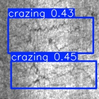
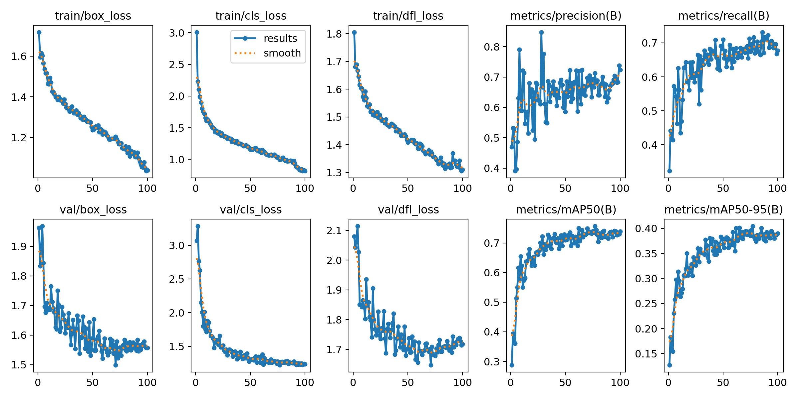

# 基于 YOLOv8 的钢材表面缺陷检测系统

面向工业质检场景的钢材表面缺陷检测项目：使用 YOLOv8n 在 NEU-DET 数据集上完成训练，实现 6 类缺陷的自动识别与定位，支持单张图片检测，GPU 下单张推理约 5–7ms。

## 效果演示

| 裂纹 (crazing) | 夹杂 (inclusion) | 划痕 (scratches) |
|---|---|---|
|  |  |  |

## 核心指标

| 指标 | 数值 |
|---|---|
| mAP50 | **0.739** |
| mAP50-95 | 0.390 |
| 单张推理耗时（RTX 4060） | 5–7ms |
| 单张推理耗时（CPU） | 约 50ms |
| 训练配置 | YOLOv8n / 100 epochs / 640×640 / batch 16 |




## 数据集

[NEU-DET](https://github.com/Marfbin/NEU-DET-with-yolov8) 钢材表面缺陷数据集：

- 1800 张 200×200 钢材表面图像
- 6 类缺陷：crazing（裂纹）、inclusion（夹杂）、patches（斑块）、pitted_surface（麻面）、rolled-in_scale（氧化皮压入）、scratches（划痕）
- 训练集 / 验证集 = 1620 / 180，YOLO 格式标注（归一化坐标）

## 项目结构

```
├── defect_detector.py    # 检测器封装：加载模型、推理、结果输出
├── best.pt               # 训练完成的模型权重
├── yolov8n.pt            # 预训练基线权重（回退用）
├── assets/               # README 演示素材
├── datasets/             # 数据集（neu_det.yaml + NEU-DET 图像与标签）
└── runs/                 # 训练与推理输出
```

## 快速开始

### 1. 环境

```powershell
python -m venv --system-site-packages .venv
.\.venv\Scripts\python -m pip install ultralytics
```

要求：Python 3.10+；建议 NVIDIA GPU（本机验证 RTX 4060，也可 CPU 运行）。

### 2. 推理

```powershell
.\.venv\Scripts\python defect_detector.py
```

脚本默认加载 `best.pt`（自训练模型），不存在时自动回退到 `yolov8n.pt`。

### 3. 训练

```powershell
.\.venv\Scripts\python -c "from ultralytics import YOLO; YOLO('yolov8n.pt').train(data='datasets/neu_det.yaml', epochs=100, imgsz=640, device=0)"
```

## 技术要点

- 迁移学习：基于 COCO 预训练的 YOLOv8n，冻结 DFL 层，在缺陷数据集上微调
- 数据管线：图片缓存 + 640×640 letterbox 预处理，Windows 下禁用多进程加载（workers=0）避免数据加载器挂起
- 推理接口：封装为 `DefectDetector` 类，支持任意权重路径，便于切换预训练/自训练模型

## 致谢

- 项目思路参考 [qunshansj/metal-defect-detection-yolo-opencv](https://github.com/qunshansj/metal-defect-detection-yolo-opencv)
- 基于 [Ultralytics YOLOv8](https://github.com/ultralytics/ultralytics)
- 数据集来自东北大学 NEU-DET

## License

MIT
