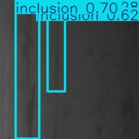
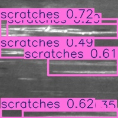
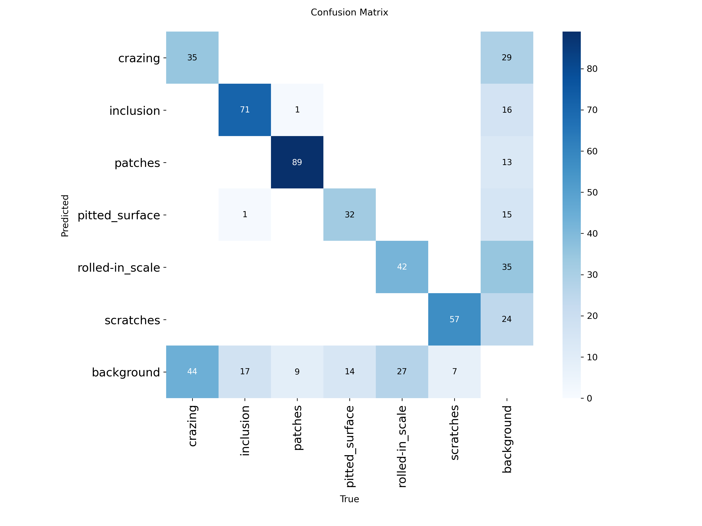

# 基于 YOLOv8 的钢材表面缺陷检测系统

面向工业质检场景的钢材表面缺陷检测项目：使用 YOLOv8n 在 NEU-DET 数据集上完成训练，实现 6 类缺陷的自动识别与定位，支持单张图片检测，GPU 下单张推理约 5–7ms。

## 效果演示

| 裂纹 (crazing) | 夹杂 (inclusion) | 划痕 (scratches) |
|---|---|---|
|  |  |  |

## 核心指标

| 指标 | 数值 |
|---|---|
| mAP50（训练记录 / 当前权重复核） | **0.739 / 0.756** |
| mAP50-95（训练记录 / 当前权重复核） | 0.390 / 0.405 |
| 单张模型推理耗时（RTX 4060，原训练环境） | 5–7ms |
| 单张推理耗时（CPU） | 约 50ms |
| 训练配置 | YOLOv8n / 100 epochs / 640×640 / batch 16 |




## 工程结论

1. **总 mAP 会掩盖明显的类别短板。** 当前权重在 180 张验证图上复核后，各类 mAP50 为：patches 0.934、scratches 0.869、inclusion 0.842、pitted_surface 0.782、rolled-in_scale 0.613、crazing 0.497。`crazing` 的验证集实例数（79）并非最少，说明问题不只是样本数量；细纹理与背景相似才是主要难点。实际部署应按类别分别设定验收标准和置信度阈值，并优先补充裂纹的难例。

2. **当前模型更适合“发现并定位”，还不适合直接做尺寸测量。** 总 mAP50 为 0.756，但 mAP50-95 只有 0.405，说明框在宽松 IoU 下能找到目标，严格 IoU 下的边界质量明显下降。若用于缺陷面积、宽度等定量判断，需要更严格的标注一致性，或改用分割模型输出缺陷轮廓。

3. **推理速度必须注明测试边界。** README 中的 5–7ms 是原训练环境下只计算模型推理的数值，不包含图像预处理、NMS 后处理和结果落盘。当前环境完整验证流程平均约 23.5ms 推理、26.2ms 前后处理；对外报告延迟时应同时给出硬件、框架版本和端到端 p95，避免把模型单步耗时当成系统吞吐。

## 数据集

[NEU-DET](https://github.com/Marfbin/NEU-DET-with-yolov8) 钢材表面缺陷数据集：

- 1800 张 200×200 钢材表面图像
- 6 类缺陷：crazing（裂纹）、inclusion（夹杂）、patches（斑块）、pitted_surface（麻面）、rolled-in_scale（氧化皮压入）、scratches（划痕）
- 训练集 / 验证集 = 1620 / 180，YOLO 格式标注（归一化坐标）

## 项目结构

```
├── defect_detector.py    # 检测器封装：加载模型、推理、结果输出
├── best.pt               # 训练完成的模型权重
├── yolov8n.pt            # 预训练基线权重（回退用）
├── assets/               # README 演示素材
├── tests/                # 权重解析与推理封装测试
├── docs/model-card.md    # 指标、延迟口径和适用边界
├── datasets/             # 数据集（neu_det.yaml + NEU-DET 图像与标签）
└── runs/                 # 训练与推理输出
```

## 快速开始

### 1. 环境

```powershell
python -m venv --system-site-packages .venv
.\.venv\Scripts\python -m pip install ultralytics
```

要求：Python 3.10+；建议 NVIDIA GPU（本机验证 RTX 4060，也可 CPU 运行）。

### 2. 推理

```powershell
.\.venv\Scripts\python defect_detector.py
```

脚本默认加载 `best.pt`（自训练模型），不存在时自动回退到 `yolov8n.pt`。
可按需指定图片、权重、置信度和输出位置：

```powershell
.\.venv\Scripts\python defect_detector.py --image demo_input.jpg --conf 0.3
.\.venv\Scripts\python defect_detector.py --weights yolov8n.pt --no-save
```

模型指标、延迟口径和适用边界见 [模型说明](docs/model-card.md)。

### 3. 训练

```powershell
.\.venv\Scripts\python -c "from ultralytics import YOLO; YOLO('yolov8n.pt').train(data='datasets/neu_det.yaml', epochs=100, imgsz=640, device=0)"
```

## 技术要点

- 迁移学习：基于 COCO 预训练的 YOLOv8n 在缺陷数据集上微调；训练参数为 `freeze: null`，未冻结 DFL 层
- 数据管线：图片缓存 + 640×640 letterbox 预处理，Windows 下禁用多进程加载（workers=0）避免数据加载器挂起
- 推理接口：封装为 `DefectDetector` 类，支持任意权重路径，便于切换预训练/自训练模型

## 致谢

- 项目思路参考 [qunshansj/metal-defect-detection-yolo-opencv](https://github.com/qunshansj/metal-defect-detection-yolo-opencv)
- 基于 [Ultralytics YOLOv8](https://github.com/ultralytics/ultralytics)
- 数据集来自东北大学 NEU-DET

## 测试

```powershell
.\.venv\Scripts\python.exe -m unittest discover -s tests -v
py -m ruff check defect_detector.py tests --select F
```

## License

MIT
